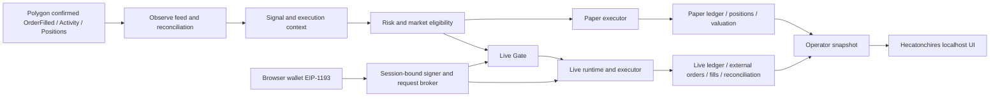

# Hecatonchires / ni-k 外部审计完整报告

> 文档版本：`2026-07-30-complete`
> 审计日期：2026-07-30（Asia/Shanghai）
> 项目：`ni-k` / Hecatonchires Polymarket 跟单控制台
> 审计对象：源码、运行时装配、数据库边界、Paper/Observe/Replay、localhost UI、桌面入口、Live Gate、钱包会话和验证证据
> 审计性质：工程与安全控制复核，不是投资建议、法律意见、合规意见或真实交易授权

本文件是给外部审计、技术尽调和生产接入评审使用的完整版本。它刻意把以下三件事分开：

1. **代码能力是否已经实现；**
2. **隔离测试和 Paper/Observe 证据是否通过；**
3. **真实钱包、真实资金、真实订单和用户当次授权是否已经发生。**

其中第 1、2 项通过，不会自动推导出第 3 项通过。

---

## 0. 一页结论

### 0.1 当前安全结论

当前数据库和最近一次安全启动复核都满足：

```text
execution_mode   = PAPER
live_gate_state  = LIVE_DISABLED
liveAllowed      = false
```

最近一次只读数据库检查：

```text
quick_check                = ok
foreign_key_check          = empty
live_executions            = 0
live_orders                = 0
live_order_attempts        = 0
live_fills                 = 0
nonzero_live_positions     = 0
state_reason               = LIVE_WALLET_SESSION_DISCONNECTED
```

本次审计没有：

- 加载私钥、助记词或 seed；
- 把私钥写入 Node、浏览器、配置文件、日志或审计包；
- 发送真实 CLOB 订单；
- 执行真实 approve、cancel、redeem 或其他链上写入；
- 进行真实资金成交；
- 因测试通过而自动打开 Live。

### 0.2 工程实现结论

以下生产候选能力已经在代码和隔离测试层实现：

- Polygon 目标交易采集、多源一致性、Signal 和执行上下文；
- Paper 账本、Reservation、Position、估值、PnL、恢复和对账；
- Live 账户、Live 账本、Live Executor、Live Runner、外部订单/成交/仓位对账；
- 浏览器钱包公开身份挑战、短期 session lease、账户/网络绑定和失效撤销；
- EIP-6963、OKX 延迟注入和多 provider 选择；
- EOA 与 Polymarket Gnosis Safe 资金地址的发现和 owner 关系校验；
- 浏览器钱包 signer、惰性认证 CLOB、只读余额/allowance/仓位 provider；
- 官方地域限制、合规、时钟安全、市场数据和钱包授权接口；
- Live Gate、arming、最终确认、启动恢复、紧急停用和 fail-closed 回滚；
- 目标地址、Paper/Live 模式、可编辑跟单参数、目标/我的对照卡片、执行明细和后台明细；
- 桌面单一入口、安全退出、重复启动保护和服务重启后的 Gate 复位。

### 0.3 生产结论

当前更准确的判定是：

| 维度 | 判定 | 说明 |
|---|---|---|
| 代码结构 | 已形成 | 生产路径和隔离路径均有明确接口 |
| 安全 Gate | 通过当前安全基线 | 当前强制保持 Paper、Live disabled |
| Paper/Observe 验证 | 通过既定口径 | 跨 Core 汇总已完成，但自然成交覆盖有限 |
| 钱包身份链 | 已实现 | 当前审计快照为断开状态，未把旧签名当成当前授权 |
| 真实外部 provider | 未完成当前轮验收 | 需在新钱包会话中重新取得新鲜证据 |
| 真实订单/成交/PnL | 未证明 | 隔离测试不能替代真实资金验收 |
| 实盘授权 | 未发生 | 需要所有生产前置条件通过后由用户当次明确确认 |

因此当前系统应被标记为：

```text
PRODUCTION-CANDIDATE
REAL-LIVE-TRADING = NOT AUTHORIZED / NOT PROVEN
```

---

## 1. 审计对象、范围和方法

### 1.1 审计对象

审计对象是独立的 ni-k Polymarket 跟单系统，不复用旧版 Bot 的代码、数据库、仓位、账本或执行语义。

当前目标地址：

```text
0x1f9e15f39bbd5d163b0eacf0fbef647ced9e4f1a
```

旧目标地址、旧 Core、旧 Campaign 只能作为历史证据，不能重新绑定到当前运行目标，也不能把不同 Core 的时长伪称为单一 Campaign 原生时长。

### 1.2 本次纳入范围

- `src/` 领域、执行、Paper、Live、Observe、Replay、Operator 和验证代码；
- `tests/` 全套回归与集成测试；
- SQLite schema、迁移、账本、Gate 和安全快照；
- `prototype/live-ui/` localhost 控制台；
- `scripts/launch-hecatonchires-ui.command` 和桌面入口；
- Live production validation artifact；
- Paper/Observe/Replay 报告与审计包；
- 钱包、CLOB、只读 provider、合规、geoblock 和时钟安全边界；
- 本次临时端口启动、心跳、退出和数据库复核。

### 1.3 本次不纳入的证明

以下事实不能从本文件推导，除非另有真实外部证据：

- 用户钱包当前实际余额；
- 当前网络出口对应的地域允许结果；
- 当前钱包的真实 allowance；
- 当前钱包的真实 CLOB 认证状态；
- 真实订单是否可以成交；
- 真实 approve、submit、cancel、redeem 的链上结果；
- 真实 FILL、POSITION_UPDATE、FEE、PnL；
- 任何法律、税务、投资或地域合规结论。

### 1.4 证据等级

本审计按以下优先级解释证据：

1. 当前源码和精确运行时哈希；
2. 全套测试与类型/语法/差异检查；
3. `live-production-validation-v2` 工件；
4. 只读数据库安全快照；
5. Paper/Observe/Replay 报告；
6. localhost UI 只读快照；
7. 历史文档和人工截图。

人工截图只能证明当时页面呈现，不能替代后端数据库或钱包弹窗的事实。

---

## 2. 审计基线和版本身份

### 2.1 Git 与运行时身份

| 项目 | 值 |
|---|---|
| 当前分支 | `codex/operator-ui-integration` |
| 当前 HEAD（文档/包提交） | `e93db2a26fd0fdeff5e7f8b9d3e92b6b3eaa122c` |
| 精确验证运行时提交 | `b1aaa7d8d12e1c8308bc0df909eb302ebd12f7ae` |
| 运行时哈希 | `85fb3f113414c4e95181e9057ede31b5fce065b58831c1e6e47ae60846115d2c` |
| validation schema | `live-production-validation-v2` |
| validation status | `PASSED` |
| 生成时间 | `2026-07-30T02:49:06.442Z` |
| 测试文件 | `77` |
| 测试数量 | `939` |
| TypeScript | `true` |
| 全套测试 | `true` |
| diff check | `true` |
| `runtimeSourceDirty` | `false` |
| `sourceCodeDirty` | `true` |

`sourceCodeDirty=true` 记录的是整个工作树在生成工件时存在非运行时文件变化；当前未提交的内容为 `agent_memory/` 和 `docs/research/` 记录文件。`runtimeSourceDirty=false` 表示纳入生产运行时哈希的代码、测试、配置和入口没有脏改动。外部审计若要求完全清洁的源码输入，应使用精确的运行时提交归档，而不要把工作树中的记录文件误当成生产代码。

### 2.2 依赖和运行环境

| 项目 | 版本/边界 |
|---|---|
| Node.js | `>=24.14.0 <25` |
| pnpm | `11.9.0` |
| TypeScript | `6.0.3` |
| Vitest | `4.1.10` |
| viem | `2.55.0` |
| Polymarket CLOB client | `1.0.8` |
| SQLite | Node 24 `node:sqlite` |
| Package version | `0.1.0` |

Node `node:sqlite` 的 experimental warning 不影响测试结果，但正式发布时应固定 Node 版本并记录运行环境。

### 2.3 领域版本

当前代码中的主要行为版本：

| 领域 | 版本 |
|---|---|
| Schema | `2.32.0` |
| Signal | `1.11.0` |
| Strategy | `2.9.0` |
| Risk | `1.10.0` |
| Replay | `2.5.0` |
| Paper | `1.18.0` |
| Live | `1.16.0` |
| Validation | `1.9.0` |
| Operational | `1.9.0` |
| Ruleset | `v1.11.0` |
| Config | `v1.7.0` |

旧 Ruleset 通过 Ruleset hash 和 Config version 保持历史语义，不允许新代码重新解释旧执行。

---

## 3. 当前运行和安全快照

### 3.1 4173 主端口现状

本次审计开始时，`127.0.0.1:4173` 没有监听进程。这个事实只说明本地控制台进程已经退出，不等于 Live 被启动或数据库不安全。数据库状态随后单独核对为 `PAPER + LIVE_DISABLED`。

因此必须区分：

```text
服务在线状态  ≠ 交易安全状态
```

用户日常使用时双击桌面入口即可重新启动本地控制台；启动前会再次检查并复位残留的 Live Gate。

### 3.2 新鲜临时端口启动复核

为了不改变主端口和用户浏览器状态，本次使用临时端口 `4179` 做了安全复核：

| 项目 | 结果 |
|---|---|
| 启动 | 成功 |
| 实例 ID | `6ac4cd91-5df6-412d-9aae-a1bcd3cc307b` |
| 启动时间 | `2026-07-30T05:34:53.639Z` |
| 首次快照 | `2026-07-30T05:35:00.657Z` |
| 后续快照 | `2026-07-30T05:40:29.777Z` |
| `generatedAt` 是否推进 | 是 |
| execution mode | `PAPER` |
| Gate | `LIVE_DISABLED` |
| `liveAllowed` | `false` |
| wallet session | `DISCONNECTED` |
| Live runtime | `NOT_CONFIGURED` |
| Paper runtime | `STOPPED` |
| comparisons | `50` |
| 安全停止 | 成功 |
| 停止后端口 | 已关闭 |

该复核没有连接钱包、调用 wallet request、启动 Paper campaign 或发送交易。

### 3.3 数据库当前基线

只读 SQL 结果：

```text
quick_check = ok
foreign_key_check = empty

execution_mode       PAPER
live_gate_state      LIVE_DISABLED
state_reason         LIVE_WALLET_SESSION_DISCONNECTED

live_executions      0
live_orders          0
live_order_attempts  0
live_fills           0
nonzero_live_positions 0
```

数据库文件：

```text
data/phase0/phase0.sqlite
```

数据库不应被外部审计方直接写入。除非明确进行可恢复备份和迁移演练，否则所有核对使用 SQLite read-only 模式。

### 3.4 Paper 与 Live 显示含义

- Paper 的 `1,000.00 pUSD` 是隔离测试账户初始余额；
- Live 钱包余额来自生产钱包只读快照，不再从 Paper 回退；
- 没有新鲜 Live 余额时，页面显示采集时间和“数据已过期”；
- 0 pUSD 不会作为生产准备的最低准入条件；
- 真正提交某一笔 BUY 时，余额和 token-specific allowance 仍需在该笔执行前通过；
- Live 余额、启动前外部仓位和本系统管理仓位在 UI 与对账中分开。

### 3.5 电脑关机、重启、睡眠和合盖

系统不是要求电脑永远开机。电脑可以正常关机、重启、注销或临时退出；是否持续运行只
取决于用户是否希望 Paper/Observe 在这段时间继续采集和处理数据。

推荐的关机流程：

1. 如果页面可访问，点击右上角“退出”；
2. 等待页面显示“Hecatonchires 已安全关闭”；
3. 再执行 macOS 关机、重启或关闭 Terminal；
4. 下次使用时双击桌面的 `Hecatonchires.command`。

桌面入口和 Node 服务都处理 `SIGTERM`、`SIGINT` 和 `SIGHUP`。关闭入口终端或系统正常
结束进程时，入口会等待 `shutdownSafety()`，该流程会：

- 停止 Paper/Live runtime；
- emergency-disable Live Gate；
- 撤销钱包 session lease；
- 取消未完成的浏览器钱包请求；
- 等待子进程退出；
- 超时后才对本地服务做最后的进程终止。

重新开机后的默认行为：

- 不自动恢复 Live；
- 不自动重新连接钱包；
- 不自动发送订单；
- 启动前重新读取数据库并复位残留的 `LIVE`、`LIVE_ARMING` 或 `LIVE_ACTIVE`；
- 只有用户重新双击入口、重新连接钱包并完成当次确认后，才会再次进入后续流程；
- 已保存的目标地址、Ruleset 和 Live 限额保留，不要求重复填写。

电脑关机期间：

- Paper/Observe 不会在后台继续运行；
- 不会因为电脑关机而产生新的 Signal、订单或成交；
- 若需要连续 Observe/Paper，必须保持电脑唤醒、供电并让本地服务持续运行；
- 合盖或睡眠可能造成调度空窗，唤醒后系统会根据 checkpoint、时间、数据新鲜度和对账
  结果恢复或 fail closed，不会把缺失期间猜成正常成交。

强制断电、`kill -9`、系统崩溃或磁盘损坏无法保证最后一次安全退出动作完成。对此系统的
处理原则是：下次启动先恢复并停用残留 Gate，保留原始失败证据，禁止自动进入 Live。若
外部订单已经在断电前提交，系统不能撤销区块链已经发生的事实；重新启动后必须先完成
外部订单/成交/仓位对账，再决定是否允许任何后续动作。

---

## 4. 系统架构和数据流

### 4.1 总体数据流



### 4.2 代码分层

| 层 | 主要目录 | 责任 |
|---|---|---|
| Domain | `src/domain/` | 固定点数、模型、状态机、幂等、版本和 Ruleset |
| Observe | `src/observe/` | Polygon 事件、唤醒、分页、位置投影、重组和对账 |
| Signal context | `src/signal-context/` | 市场元数据、outcome set、执行截止和目标绑定 |
| Execution | `src/execution/` | 买入金额、最小额、盘口、手续费、SELL 和估值恢复 |
| Risk | `src/risk/` | Ruleset 一致性、资金、敞口、时钟、市场和信号完整性 |
| Paper | `src/paper/` | 隔离执行、匹配、现金、Reservation、仓位和 Campaign |
| Live | `src/live/` | Live Store、Executor、Runner、Gate、对账、恢复和身份绑定 |
| Operator | `src/operator/` | 钱包 session、生产装配、UI snapshot、控制动作和诊断脱敏 |
| Validation | `src/validation/` | Paper/Observe/Replay/数据库/Live Gate 证据 |
| Persistence | `src/infra/sqlite/` | SQLite schema、迁移、备份和数据库初始化 |
| UI | `prototype/live-ui/` | 只读 snapshot 渲染和同源控制请求 |

### 4.3 Observe 采集策略

- Polygon 已确认 `OrderFilled` 每约 `1 s` 扫描；
- 公共 WebSocket 只作为 wake hint，不作为唯一事实来源；
- Trades/Activity 约 `3 s` 交叉确认；
- Positions 和 pUSD 约 `15 s` 全量核对；
- 新事件、gap 恢复、Signal 和状态变化立即固化 Capture、Checkpoint 和 Reconciliation；
- 事件游标、区块哈希、交易哈希、order hash 和 source event key 参与幂等。

### 4.4 Paper/Live 共享与隔离

Paper 与 Live 共享：

- Signal/Context；
- Risk 规则和市场资格；
- 盘口、手续费、VWAP 和 FAK 语义；
- Reservation、Position、Ledger 和恢复原则。

Paper 与 Live 隔离：

- 账户 ID；
- 现金账本；
- 订单与成交；
- runtime 生命周期；
- 钱包、Signer、CLOB 和链上 provider；
- Live Gate 和用户授权。

任何 Paper 结果都不能直接写入 Live 账本。

---

## 5. 模式、Gate 和状态机

### 5.1 状态定义

| 状态 | 含义 | 是否允许真实订单 |
|---|---|---|
| `PAPER + LIVE_DISABLED` | 默认安全态 | 否 |
| `PAPER + LIVE_DISABLED` 且 Paper `RUNNING` | 隔离跟单运行 | 否 |
| `LIVE + LIVE_ARMING` | 生产启动中，尚未最终确认 | 否 |
| `LIVE + LIVE_ACTIVE` | 所有 Gate 和最终确认通过 | 仅此状态具备路径 |
| `LIVE` 但 Gate disabled | 异常/残留态，启动时必须复位 | 否 |
| `RECOVERY_REQUIRED` | 需要人工/系统恢复 | 否 |

`liveAllowed` 不是历史常量，而是严格投影：

```text
execution_mode == LIVE
AND live_gate_state == LIVE_ACTIVE
```

### 5.2 Live 一键流程

用户点击一次“切换 Live”后，后台按以下顺序执行：

1. 检查钱包 session lease；
2. 检查正式钱包、网络、chain ID 和交易资金地址；
3. 检查静态验证工件和运行时哈希；
4. 刷新官方地域、合规、时钟和只读余额/allowance/仓位；
5. 执行 Live 对账和启动前仓位基线；
6. 进入 `LIVE_ARMING`；
7. 运行启动恢复和遗留订单/仓位检查；
8. 启动空闲 Live runtime，但在最终确认前不消费 Signal；
9. 再次执行新鲜 Gate 检查；
10. 用户完成最终确认后写入 `LIVE_ACTIVE`；
11. 只有之后才允许 Live runner 消费新 Signal。

### 5.3 失败回滚

任一步失败必须：

- 停止空闲 runtime；
- 取消未完成钱包请求；
- 撤销或失效旧 session binding；
- emergency-disable Gate；
- 再次读取数据库确认 `PAPER + LIVE_DISABLED`；
- 返回结构化失败码和失败阶段；
- 不把部分成功呈现为“Live 已启动”。

### 5.4 手动入口的边界

高级诊断入口保留用于审计和恢复，但不能绕过持久化 Gate：

- 手动启动 Live 要求 `LIVE + LIVE_ACTIVE`；
- 手动重试 Live 执行要求 `LIVE + LIVE_ACTIVE`；
- Live 对账要求已装配 LiveRuntime；
- 未连接钱包时返回结构化 `LIVE_RUNTIME_NOT_CONFIGURED` 类错误；
- 紧急停用不依赖钱包连接，始终优先可用。

---

## 6. 钱包、凭据和链上边界

### 6.1 身份连接

连接钱包只完成公开身份控制权证明：

1. 后端生成一次性 challenge；
2. challenge 绑定 Polygon chain ID、时间和 session；
3. OKX/浏览器钱包执行 `personal_sign`；
4. 后端验证签名恢复出的地址；
5. 建立短期 session lease；
6. 后续 action 通过 session binding 校验。

该签名不等于订单授权，也不移动资金。

### 6.2 Provider 选择

前端支持：

- EIP-6963 provider discovery；
- OKX 延迟注入；
- `window.okxwallet` / `window.okxwallet.ethereum`；
- `ethereum.providers`；
- 传统 `window.ethereum` 兼容路径。

多标签页通过 Web Locks 和后端 request broker 避免争抢同一签名请求。浏览器扩展弹窗不能被后台静默确认。

### 6.3 EOA 与 Safe

生产配置区分：

```text
walletAddress          = EOA signer
tradingWalletAddress   = Polymarket trading/funder address
signatureType          = POLY_GNOSIS_SAFE / EOA 等
```

如果资金地址是 Polymarket Gnosis Safe：

- 系统从 Gamma profile 发现资金地址；
- 通过 Polygon `getOwners()` 验证 EOA owner 关系；
- Safe 现有 outcome-token 仓位可被记录为不可变启动前基线；
- 启动前基线不写入本系统可卖 Live positions；
- 外部对账比较“启动前基线 + 本系统管理仓位”；
- Safe allowance 或具体 token allowance 不足时，延迟到具体订单检查；
- 任何需要链上授权的操作仍需钱包逐笔确认。

### 6.4 私钥边界

系统不读取：

- 私钥；
- seed；
- 助记词；
- 可复用 CLOB/API secret；
- 浏览器扩展内部密钥。

Signer 只通过钱包 request broker 发送当前 session 的精确请求。签名意图可能为了 crash recovery 写入受限 SQLite 字段，但该字段不进入 UI、普通日志、快照或外部审计包。

### 6.5 Session 撤销

以下任一事件都会撤销 action binding 并安全停用：

- 钱包断开；
- 账户变化；
- chain ID 变化；
- session 过期；
- 页面心跳停止；
- 配置/限额/交易资金地址变化；
- 源码或验证工件版本失配；
- provider 被替换；
- runtime identity 漂移。

版本失配应返回 `LIVE_RUNTIME_STALE_RECONNECT_REQUIRED`，而不是把钱包签名成功伪装成已完成 Live 装配。

---

## 7. Live 生产路径

### 7.1 默认装配组件

`assembleDefaultConnectedLiveRuntime` 在钱包身份验证后惰性装配：

- Browser wallet CLOB signer；
- Session-authenticated CLOB client；
- Polygon readonly wallet provider；
- balance/allowance provider；
- Official geoblock provider；
- compliance provider；
- clock safety provider；
- public CLOB market data；
- Polygon receipt provider；
- browser wallet allowance manager；
- browser wallet redeem adapter；
- Live account registry；
- Live Gate；
- Live Runtime；
- Live Executor；
- external reconciliation。

装配本身不等于 arming，也不等于下单。

### 7.2 BUY 策略

当前默认 Ruleset 关键语义：

- 每笔目标 BUY 独立判断、独立 FAK，不把未成交额累加到后续订单；
- 目标成交额占可见目标资金 `<1%` 时，最低金额通常为 `1 pUSD`，按市场最低可执行额抬升，硬上限 `5 pUSD`；
- 市场最低额超过 `5 pUSD` 时跳过；
- 首次实际开仓不计小额追单；
- 后续 `<1%` 实际成交最多 `9` 次；
- 0 fill、取消和过期不计追单次数；
- BUY 含手续费后的 VWAP 必须在目标价 `90%—105%` 范围内，且不高于 `0.95`；
- 盘口过旧、市场结束时间缺失、估值不完整、时钟不安全或对账异常时不消费。

### 7.3 SELL 与止损

- 目标 SELL 先取消或缩减等待中的 BUY；
- 只卖本系统识别并拥有的真实仓位；
- 普通 `STANDARD_TRADE` SELL 达到或超过 `95%` 时按本轮完整退出；
- MERGE/CONVERSION 等 `COMBO_ACTIVITY` 不套用普通 SELL 阈值；
- 最低卖量不足时尾仓保持 `EXIT_PENDING`，不为凑最低量而放大；
- 止损退出后锁定该标的重新 BUY，直到本轮持仓、等待、在途和结算义务归零；
- SELL 的已实现 PnL 绑定本笔执行账本，不取同一 Signal 下其他仓位的累计结果。

### 7.4 资金与限额

UI 默认限额：

| 参数 | 默认值 |
|---|---:|
| Live 资金上限 | `10 pUSD` |
| 单笔上限 | `1 pUSD` |
| 总敞口上限 | `3 pUSD` |
| 单日亏损上限 | `1 pUSD` |

配置约束：

```text
单笔上限 ≤ 总敞口上限 ≤ 资金上限
单日亏损上限 ≤ 资金上限
```

已移除的隐藏限制：

- 固定 `100 pUSD` 前端/后台硬编码上限；
- 与 UI 参数冲突的第二套绝对总敞口上限；
- 固定“连续亏损 5 次即阻断”的隐式规则；
- 因钱包余额小于资金包而拒绝生产准备；
- 无法向用户解释的固定最低余额门槛。

仍保留的执行必要检查：

- 具体订单的实际余额；
- token-specific allowance；
- 盘口和最小订单量；
- 价格和滑点；
- 市场结束时间；
- 账户敞口和日损；
- 外部仓位和账本对账。

### 7.5 特殊操作

- MERGE：只有完整 outcome set、余额和定价证据齐备才投影退出；
- SPLIT：不执行链上铸造，新增腿进入 historical bucket；
- CONVERSION：不执行链上转换；source 有本轮仓位时可生成等价 TARGET_SELL，destination 隔离；
- Replay：没有完整持久化证明时保持 `INCOMPLETE`；
- 无法证明完整 outcome set、事件归属或外部仓位时继续 fail closed。

---

## 8. Paper、Observe 和 Replay 证据

### 8.1 Paper 跨 Core 汇总

已完成的跨 Core Paper 汇总：

```text
86,400,012 ms
```

该数字由独立 Core/Session 证据组成：

- 旧 Core 独立有效轮次；
- 新 Core 正常轮次；
- 一轮最终估值外部异常后按用户授权的独立业主汇总；
- 最终修复验证轮。

该汇总没有改写原始 Campaign 的内建计时，也没有伪称为单一 Core 的连续运行。

### 8.2 最终 Paper 样本

最终 Paper 证据的边界：

- 有效轮次完成；
- Signal、Risk、Execution、Ledger、Position 和估值路径通过；
- 真实 Paper fill 样本有限或为 0；
- 不能把 Paper fill 结果解释为真实资金成交；
- 不能把没有自然 FILL 的测试解释为真实 PnL。

### 8.3 Observe Only

已保留两轮独立 Observe Only 通过报告：

| 项目 | 第一轮 | 第二轮 |
|---|---:|---:|
| Run | `3a9f1686-ba4a-4dd1-9426-da20cd8b36b8` | `aead6def-fc4d-466a-87c6-d665255acde0` |
| 有效时长 | 约 8 小时 10 分钟 | 约 8 小时 10 分钟 |
| scheduling gap | `0` | `0` |
| major desync | `0` | `0` |
| unrecovered connection gap | `false` | `false` |
| 最终同步 | `SYNCED` | `SYNCED` |
| 验收 | `SHORT_SOAK_PASSED` | `SHORT_SOAK_PASSED` |

第二轮完成后曾因 launchctl KeepAlive 推断启动短第三轮；该轮约 77 秒后安全中止，明确标记 `ABORTED`，不计入任何时长，原始证据保留。

### 8.4 证据限制

以下样本仍然需要真实生产验收：

- 自然 FILL；
- POSITION_UPDATE；
- FEE；
- 真实 CLOB 成交；
- 真实 PnL；
- 真实 approve/submit/cancel/redeem；
- 真实网络重组下的恢复。

---

## 9. Ruleset、参数和配置保存

### 9.1 配置来源

配置来源只有：

1. 项目默认 Ruleset；
2. UI 保存的用户参数；
3. 当前 Campaign/Execution 持久化的 Ruleset snapshot。

历史 execution 使用自己的 Ruleset hash，不随当前 UI 改动。

### 9.2 UI 保存语义

- 目标地址：输入后点击“确认”；
- 跟单设置：展开“跟单设置”，修改后点击“保存参数”；
- Live 风险参数：展开“Live 安全状态”，修改后点击“保存参数”；
- 保存配置后，下一次 Campaign/Live 流程读取新值；
- 相同值重复保存不会无故断开钱包；
- 身份、网络、交易资金地址或风险参数真正变化时，旧 runtime/session 会被撤销；
- 默认按钮恢复项目默认值，不删除历史执行证据。

### 9.3 当前应重点核对的参数

```text
buyPriceMinRatioPpm
buyPriceMaxRatioPpm
buyMaximumPricePpm
buyFirstEntryMinimumAmountMicros
buyMarketMinimumAutoLiftCapMicros
smallFollowBuyMaxCount
waitRatioPpm
maxWaitMs
followSellMaxSlippagePpm
stopSellMaxSlippagePpm
stopTriggerRatioPpm
fallbackAmountMicros
paperInitialBalanceMicros
paperMaxSingleTradePpm
paperMaxMarketExposurePpm
paperMaxPositionExposurePpm
```

Live 资金、单笔、总敞口和单日止损属于单独的 Live production config，不应与 Paper 初始余额混淆。

---

## 10. UI 与 Operator 控制面审计

### 10.1 UI 必须展示的事实

- 当前 `PAPER` 或 `LIVE`；
- 当前 Gate 状态；
- 目标地址；
- 当前总权益、可用现金、持仓价值、已实现 PnL；
- 当前目标交易与“我的情况”；
- 我的执行状态、成交价、投入、实际 PnL；
- Live 钱包 session、交易资金地址、网络、Signer 状态；
- 钱包余额采集时间和过期提示；
- 生产前置条件和失败原因；
- 执行明细和后台明细。

### 10.2 真值来源

页面不自行推导关键资金和交易状态。页面通过：

```text
GET /api/operator/snapshot
```

读取后台快照；写操作通过同源 localhost API。模式、Gate、账户、账本和 LiveAllowed 以数据库和后端 capability 为准。

### 10.3 UI 已修复的典型问题

- Live 模式读取 Paper `1,000/1,000`；
- 旧钱包账户更新时间较晚导致误选；
- 截断明细导致仓位数量错误；
- SELL 读取同 Signal 的错误累计 PnL；
- Paper runtime 状态代替 Live runtime；
- 纯时间轮询不刷新“过期”标签；
- Paper 模式复用 Paper freshness 导致过期 Live 余额显示“更新”；
- OKX provider 延迟注入造成扩展确认后页面仍显示未连接；
- chain ID 数字/十六进制/十进制字符串差异；
- Gate 已关闭但后台仍运行时页面没有警告；
- 手动 Live 启动/重试绕过持久化 Gate。

### 10.4 时间与新鲜度

- 页面轮询约每 `3 s`；
- 纯时间字段原位更新，不整页替换；
- Live 余额/估值超过 `60 s` 显示“数据已过期”；
- 估值不完整显示“待同步”；
- 服务实例变化时页面自动刷新到新实例；
- 钱包 session 有 `lastSeenAt/expiresAt`，心跳停止会失效。

### 10.5 UI 不是安全边界

即使有人修改前端 DOM 或请求参数，后端仍必须重新检查：

- localhost host 和 mutation Origin；
- JSON 字段；
- 当前账户；
- 当前 execution mode；
- Gate；
- session binding；
- Ruleset；
- 余额/allowance；
- 对账；
- provider capability。

---

## 11. 数据库、账本和迁移

### 11.1 主要表族

| 表族 | 代表表 |
|---|---|
| Gate | `live_gate_state`, `live_gate_runs`, `live_gate_prerequisites` |
| Live account | `live_accounts`, `live_wallets`, `live_account_state_transitions` |
| Live order | `live_executions`, `live_orders`, `live_order_attempts`, `live_fills` |
| Live ledger | `live_cash_ledger`, `live_reservation_ledger`, `live_pnl_ledger`, `live_fee_ledger` |
| Live position | `live_positions`, `live_execution_positions` |
| Live safety | `live_wallet_position_baselines`, `live_reconciliation_runs`, `live_recovery_runs` |
| Paper | `paper_positions`, `paper_execution_positions`, Paper campaign/session tables |
| Observe | Capture、checkpoint、reconciliation、position projection tables |
| Audit | immutable evidence、source version、Ruleset hash、config version |

### 11.2 账本不变量

- 现金和 reservation 不得为负；
- order/fill/execution 必须有可追溯 idempotency key；
- fill 必须有对应 execution/order；
- position 只代表本系统管理仓位；
- 启动前钱包仓位进入独立 baseline；
- 外部对账不能通过删除历史记录来“修平”差异；
- `MAJOR_DESYNC`、无法归属的 gap、损坏 JSON 和未证明特殊操作继续阻断；
- 账本、仓位、Gate 和 runtime 状态必须能在快照中互相解释。

### 11.3 迁移和版本

当前数据库已迁移到 Schema `2.32.0`。近期关键迁移包括：

- Paper 跨 Campaign runtime handoff；
- 特殊活动投影；
- Live 启动前钱包仓位基线；
- Gate/runtime safety；
- 精确 sizing 和市场约束；
- execution source/version provenance。

迁移前应优先保留 SQLite 备份，不应手工删表或直接改写 Gate。

### 11.4 敏感字段

`live_orders.signed_payload_json` 可能保存 crash recovery 所需的精确签名意图。当前措施：

- runtime database 和新备份使用 `0600`；
- Operator UI 使用 `umask 077`；
- 普通 snapshot、UI、审计包不返回该字段；
- 外部审计包不包含完整 runtime database；
- 生产环境仍需要全盘加密、受控系统账号和备份访问控制。

---

## 12. 测试与验证矩阵

### 12.1 已执行命令

```bash
pnpm exec tsc --noEmit
pnpm test
node --check prototype/live-ui/app.js
node --check prototype/live-ui/server.mjs
zsh -n scripts/launch-hecatonchires-ui.command
git diff --check
pnpm validate:live-production
```

### 12.2 全套结果

```text
Test Files  77 passed
Tests       939 passed
```

### 12.3 测试覆盖分类

| 类别 | 代表测试 |
|---|---|
| Domain | fixed、state-machine、idempotency、versioning |
| Observe | order-filled feed、pagination、reconciliation、position projection |
| Signal/Risk | signal integrity、target binding、risk manager、market constraints |
| Paper | executor、matching、campaign、clock safety、recovery、account selection |
| Live | Gate、executor、runner、reconciliation、crash recovery、identity binding |
| Wallet | EIP-1193、OKX provider、session、request broker、signer |
| Production assembly | account、prerequisites、CLOB、readonly wallet、on-chain adapter |
| Operator | snapshot、actions、process lifecycle、status、launcher |
| Validation | database、Paper consistency、Replay evidence、isolated proof |
| Security | redaction、immutability、origin/host checks、safe child environment |

### 12.4 当前 validation artifact

文件：

```text
data/operator/live-production-validation.json
```

关键字段：

```json
{
  "schemaVersion": "live-production-validation-v2",
  "status": "PASSED",
  "sourceCodeCommit": "b1aaa7d8d12e1c8308bc0df909eb302ebd12f7ae",
  "liveRuntimeHash": "85fb3f113414c4e95181e9057ede31b5fce065b58831c1e6e47ae60846115d2c",
  "runtimeSourceDirty": false,
  "testFileCount": 77,
  "testCount": 939,
  "typecheckPassed": true,
  "fullTestPassed": true,
  "diffCheckPassed": true
}
```

验证工件引用：

```text
finalPaperReportSha256 =
e78c90143aba9a1ba3fece487c5deb96e49c41eae528a3cebd561445bf641bce

isolatedVerificationSha256 =
76752e4788a8e37d4f1a2a2cd9cf85634c7fc662aa8cd9393b0611babca75a63
```

### 12.5 新鲜启停复核

本次外部审计版生成前，已在 `4179` 完成：

1. 启动本地服务；
2. 读取快照；
3. 等待约 5 分钟并再次读取 `generatedAt`；
4. 确认实例 ID 不变、时间推进、Gate 仍关闭；
5. 发送安全停止；
6. 确认临时端口关闭；
7. 再次只读检查 SQLite。

此复核没有触碰钱包或交易。

---

## 13. 风险登记册和审计发现

严重级别：

- `阻断级`：不能进入真实 Live；
- `高`：需要外部证据或运营控制；
- `中`：不阻止 Paper，但生产应有缓解；
- `低`：文档、体验或发布问题。

| 编号 | 严重度 | 发现 | 当前状态 | 建议 |
|---|---|---|---|---|
| F-001 | 阻断级 | 当前没有真实钱包/真实订单/真实成交证据 | 开放 | 通过只读和受限 canary 完成外部验收 |
| F-002 | 阻断级 | 当前 session 已断开，用户当次 Live 授权未发生 | 开放 | 生产前重新连接并重新明确确认 |
| F-003 | 高 | geoblock 随出口变化，不能缓存 | 已控制 | 每次 arming 取得新鲜官方结果 |
| F-004 | 高 | CLOB/allowance/余额/时钟属于外部动态依赖 | 已接线未完成真实验收 | 记录 provider 原始响应、时间和链 |
| F-005 | 高 | 自然 FILL、费用和 PnL 样本不足 | 开放 | 受限 Paper/Live canary，不能用模拟 fill 替代 |
| F-006 | 高 | signed order intent 在受限本地数据库中持久化 | 已缓解 | 0600、全盘加密、最小权限、备份访问控制 |
| F-007 | 中 | SPLIT/CONVERSION 是安全投影，不是链上复制 | 已知限制 | 单独统计受影响金额和最终退出结果 |
| F-008 | 中 | Polygon 重组和多源去重仍可能触发 fail closed | 已控制 | 保持确认深度和不可变证据 |
| F-009 | 中 | 最终估值/API 可能超时 | 已控制 | 有界重试、保留 blocker、延后结算 |
| F-010 | 中 | 当前是 localhost + Node，不是签名 macOS `.app` | 开放 | 正式发布前封装并做签名/公证 |
| F-011 | 中 | Animal Island UI 参考仓库为 CC BY-NC 4.0 | 开放 | 商业产品重新设计或完成许可审查 |
| F-012 | 低 | `node:sqlite` 有 experimental warning | 已知 | 固定 Node 版本，持续观察升级影响 |
| F-013 | 运营 | 审计开始时 4173 进程已退出 | 已解释 | 桌面入口可安全重启；数据库 Gate 不受影响 |
| F-014 | 运营 | 工作树存在非运行时记录文件变化 | 已披露 | 外部审计使用精确运行时归档和 runtime hash |

### 13.1 不应被误判为缺陷的安全阻断

以下阻断是预期行为：

- 钱包未连接时“Live 对账”不可点击；
- 0 pUSD 时不显示可交易余额，但不阻断身份装配；
- geoblock 返回 blocked 时不允许手工覆盖；
- 旧验证工件或旧 source commit 显示 `STALE`；
- 估值不完整时显示“待同步”；
- 没有完整 outcome set 时 MERGE 保持阻断；
- 不明归属的 Polygon gap 不会自动忽略；
- Live Gate 关闭时手动启动/重试返回拒绝；
- 当前服务停止时页面不可访问，但数据库仍保持安全 Gate。

---

## 14. 外部审计建议的验收顺序

### 阶段 A：固定源码和证据

1. 记录 `git rev-parse HEAD`；
2. 记录 validation artifact 的 `sourceCodeCommit` 和 `liveRuntimeHash`；
3. 使用精确 runtime source archive；
4. 记录 Node、pnpm、依赖和操作系统；
5. 保存审计包 SHA-256。

### 阶段 B：只读安全验证

1. 只读查询 `live_gate_state`；
2. 只读查询 Live execution/order/fill/position 计数；
3. 执行 `PRAGMA quick_check` 和 `foreign_key_check`；
4. 确认无私钥、seed、真实 CLOB secret；
5. 确认 `runtimeSourceDirty=false`。

### 阶段 C：服务生命周期验证

1. 用临时端口启动；
2. 连续读取两个 snapshot；
3. 确认 `generatedAt` 推进、实例 ID稳定；
4. 确认 `PAPER + LIVE_DISABLED`；
5. 安全停止；
6. 再次查询数据库；
7. 确认没有 Live 记录增加。

### 阶段 C-0：电脑开关机验收

外部审计可以在不连接钱包的情况下验证本机生命周期：

1. 启动临时端口；
2. 读取两个时间不同的 snapshot；
3. 发送安全停止或向入口发送 `SIGTERM`；
4. 确认端口关闭；
5. 再读数据库，确认仍为 `PAPER + LIVE_DISABLED` 且 Live 计数不增加；
6. 再次启动，确认不会自动恢复 Live 或自动连接钱包。

### 阶段 D：钱包只读身份验证

仅在外部审计方和用户明确同意时：

1. 使用隔离钱包；
2. 连接 Polygon；
3. 只确认 `Hecatonchires wallet connection` personal-sign；
4. 核对恢复地址、chain ID、EOA/Safe 关系；
5. 读取余额、allowance、仓位；
6. 不点击 approve、submit、cancel、redeem；
7. 断开钱包并确认 session 撤销。

### 阶段 E：生产候选验证

只有阶段 A-D 全部通过后，才可另行设计：

- provider 新鲜性；
- geoblock 与合规证据；
- CLOB 认证；
- 时钟安全；
- allowance；
- 小额 canary；
- 订单取消；
- emergency stop；
- 外部对账；
- crash recovery。

---

## 15. 可复现命令

### 15.1 版本和工件

```bash
git rev-parse HEAD
git status --short
jq . data/operator/live-production-validation.json
```

### 15.2 代码验证

```bash
pnpm exec tsc --noEmit
pnpm test
node --check prototype/live-ui/app.js
node --check prototype/live-ui/server.mjs
zsh -n scripts/launch-hecatonchires-ui.command
git diff --check
pnpm validate:live-production
```

### 15.3 数据库只读核对

```bash
sqlite3 -readonly data/phase0/phase0.sqlite \
  "PRAGMA quick_check;
   PRAGMA foreign_key_check;
   SELECT execution_mode,live_gate_state,state_reason,updated_at
     FROM live_gate_state WHERE state_id='default';
   SELECT COUNT(*) AS live_executions FROM live_executions;
   SELECT COUNT(*) AS live_orders FROM live_orders;
   SELECT COUNT(*) AS live_order_attempts FROM live_order_attempts;
   SELECT COUNT(*) AS live_fills FROM live_fills;
   SELECT COUNT(*) AS nonzero_live_positions
     FROM live_positions WHERE CAST(current_size_micros AS INTEGER) <> 0;"
```

### 15.4 安全启动复核

```bash
OPERATOR_UI_PORT=4179 pnpm operator:ui
```

另一个终端：

```bash
curl -fsS http://127.0.0.1:4179/api/operator/snapshot
```

停止时使用 `Ctrl-C` 或服务安全退出接口。不要使用 `kill -9`，不要删除数据库文件。

### 15.5 审计包完整性

解压后：

```bash
shasum -a 256 -c SHA256SUMS
```

压缩包旁的 `.sha256` 文件用于解压前核对 ZIP 本身。

---

## 16. 外部审计证据索引

### 16.1 当前审计文档

- `docs/audit/ni-k-external-audit-complete-2026-07-30.md`：本文，完整外部审计版；
- `docs/audit/ni-k-program-audit-2026-07-30.md`：当前程序审计和操作交付摘要；
- `docs/audit/ni-k-external-audit-package-2026-07-30.md`：审计包说明；
- `docs/audit/ni-k-external-audit-2026-07-29.md`：历史详细审计，不代表当前数字。

### 16.2 验证工件

- `data/operator/live-production-validation.json`
- `data/operator/paper-campaign-isolated-verification.json`
- `data/operator/final-reports/ni-k-paper-mixed-core-24h-final-20260727-0300.md`
- `data/operator/final-reports/ni-k-paper-mixed-core-24h-final-20260727-0300.zip`

### 16.3 Observe 证据

- `data/observe/archive/observe-8h-run-3a9f1686-ba4a-4dd1-9426-da20cd8b36b8-passed.json`
- `data/observe/archive/observe-8h-run-aead6def-fc4d-466a-87c6-d665255acde0-passed.json`
- `data/observe/archive/observe-8h-run-4f36e7c7-d3ae-4648-8d65-343e0f7c3e0b-aborted.json`

### 16.4 代码重点

- `src/operator/operator-ui-server.ts`
- `src/operator/default-connected-live-runtime.ts`
- `src/operator/production-live-prerequisites.ts`
- `src/operator/live-production-build.ts`
- `src/operator/live-production-readiness.ts`
- `src/operator/live-wallet-session.ts`
- `src/operator/live-wallet-request-broker.ts`
- `src/live/live-gate-service.ts`
- `src/live/live-runtime-assembly.ts`
- `src/live/live-executor.ts`
- `src/live/live-reconciliation.ts`
- `src/live/live-crash-recovery.ts`
- `src/live/browser-wallet-clob-signer.ts`
- `src/live/browser-wallet-onchain.ts`
- `src/live/polymarket-readonly-wallet-provider.ts`
- `src/live/polymarket-clob-adapter.ts`
- `src/observe/observe-runner.ts`
- `src/paper/paper-executor.ts`
- `src/paper-validation/`
- `prototype/live-ui/app.js`
- `prototype/live-ui/server.mjs`
- `scripts/launch-hecatonchires-ui.command`

### 16.5 测试重点

- `tests/operator-ui-server.test.ts`
- `tests/operator-ui-state.test.ts`
- `tests/default-connected-live-runtime.test.ts`
- `tests/live-gate.test.ts`
- `tests/live-executor.test.ts`
- `tests/live-connected-runtime.test.ts`
- `tests/live-wallet-session.test.ts`
- `tests/live-wallet-request-broker.test.ts`
- `tests/browser-wallet-clob-signer.test.ts`
- `tests/browser-wallet-onchain.test.ts`
- `tests/polymarket-readonly-wallet-provider.test.ts`
- `tests/polymarket-clob-adapter.test.ts`
- `tests/production-live-prerequisites.test.ts`
- `tests/production-live-account.test.ts`
- `tests/operator-process-lifecycle.test.ts`
- `tests/hecatonchires-launcher.test.ts`
- `tests/diagnostic-redaction.test.ts`

---

## 17. 外部审计方签字模板

```text
项目：ni-k / Hecatonchires
审计版本：2026-07-30-complete
审计源码提交：
审计运行时哈希：
审计包 SHA-256：
审计范围：
审计排除项：

1. PAPER + LIVE_DISABLED + liveAllowed=false 的安全基线：
   [通过 / 不通过 / 未完成]

2. 源码、测试、类型检查、运行时哈希和验证工件绑定：
   [通过 / 不通过 / 未完成]

3. 钱包公开身份、chain ID、EOA/Safe 关系和 session 撤销：
   [通过 / 不通过 / 未完成]

4. 只读余额、allowance、仓位和外部对账：
   [通过 / 不通过 / 未完成]

5. Gate、arming、启动恢复、紧急停用和失败回滚：
   [通过 / 不通过 / 未完成]

6. Paper/Observe/Replay 证据及其限制：
   [接受 / 不接受 / 需补证据]

7. 真实订单、真实成交、真实 PnL 和链上写入：
   [已证明 / 未证明]

8. 是否允许进入真实 Live：
   [允许 / 不允许 / 仅允许受限 canary]

9. 若允许，账户、网络、资金、单笔、总敞口、日损、时长和撤销条件：

审计方：
日期：
签名：
```

---

## 18. 进入真实 Live 前的最终清单

必须全部满足：

- [ ] 外部审计接受当前源码和证据范围；
- [ ] 使用精确 runtime source archive；
- [ ] 当前运行时哈希与 validation artifact 一致；
- [ ] 没有 runtime dirty path；
- [ ] 4173 通过桌面入口可启动；
- [ ] 启动后自动保持 `PAPER + LIVE_DISABLED`；
- [ ] 安全退出后 Gate 和 runtime 都停止；
- [ ] 用户在新钱包 session 中完成身份签名；
- [ ] wallet、network、chain ID、EOA/Safe 关系正确；
- [ ] 只读余额、allowance、仓位和启动前 baseline 有新鲜证据；
- [ ] CLOB 认证、地域、合规和时钟 provider 有新鲜证据；
- [ ] 对账通过；
- [ ] 用户重新明确授权当前限额；
- [ ] 每笔钱包弹窗确认策略已被用户理解；
- [ ] 受限 canary 的停止、取消、对账和 emergency-disable 已演练；
- [ ] 真实订单和资金风险由用户明确接受。

任何一项未完成，都应保持：

```text
PAPER + LIVE_DISABLED + liveAllowed=false
```

---

## 19. 最终审计声明

截至本文件日期，Hecatonchires 已经形成可审计的 Paper/Observe/Live 代码架构和安全控制面，当前数据库安全基线完整，验证工件和回归测试通过，且没有真实 Live 订单或链上写入。

本文件不声称真实资金路径已经被外部网络、真实钱包、真实 CLOB、真实地域 provider 或真实成交完全验收。当前正确的交付判断是：

```text
工程实现：已形成
安全边界：当前通过
隔离验证：通过既定口径
真实生产外部事实：待补
用户当次实盘授权：未发生
真实 Live：未启用
```

因此，除非外部审计方完成剩余证据、用户在当次钱包会话中重新明确授权，并且所有 Gate 前置条件同时通过，否则系统不得进入真实 Live。
